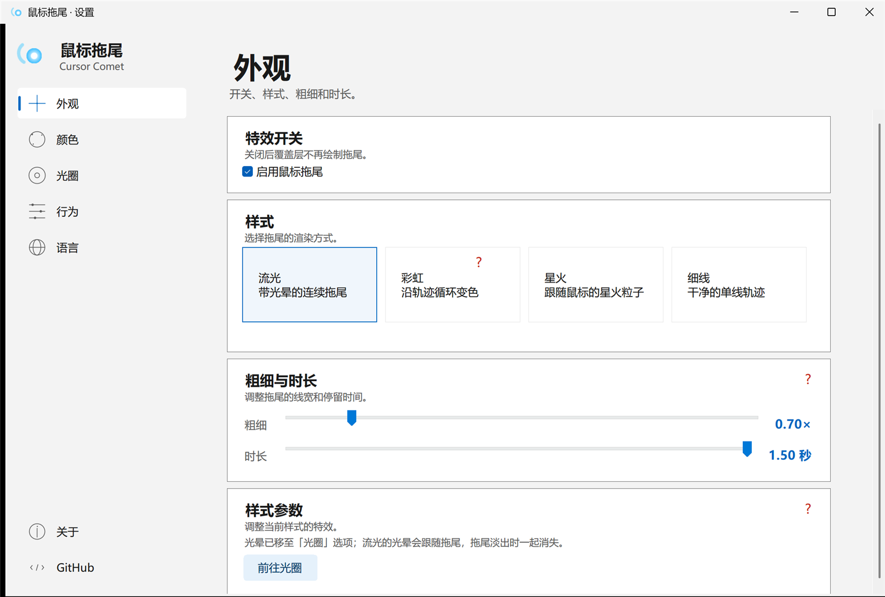
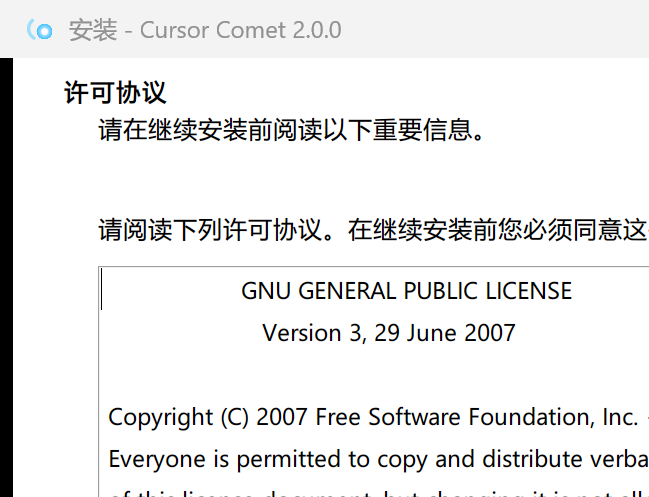

# 鼠标拖尾（Cursor Comet）

[English](README.en.md) | 中文

一个轻量的 Windows 鼠标轨迹特效小工具：透明覆盖层跟随鼠标，画出带光晕的拖尾，**不挡点击、不抢焦点**。

> **预览版 / Preview**：1.x 为开发预览，功能和配置格式可能变化；2.0 前不建议作为日常唯一版本。反馈请附 Windows 版本、缩放比例和 `%APPDATA%\CursorComet\error.log`。

[](https://github.com/cwslz/cursor-comet/actions/workflows/build.yml)
[](https://github.com/cwslz/cursor-comet/releases/latest)
[](LICENSE)






## 下载 / 快速开始

### 安装版（推荐）

从 [Releases](https://github.com/cwslz/cursor-comet/releases/latest) 下载 `CursorComet-Setup.exe`，双击安装。

- 默认安装到 `%LOCALAPPDATA%\Programs\CursorComet`，不需要管理员权限；
- 标准 Inno Setup 6 向导：语言（中文 / English）→ 许可协议 → 安装位置 → 附加任务 → 安装进度 → 完成；
- 完成页可勾选“启动 Cursor Comet”，点“完成”退出；
- 自动创建开始菜单快捷方式（打开主界面），可选桌面快捷方式；
- 卸载使用“设置 → 应用 → 已安装的应用”，或安装目录里的 `unins000.exe`；卸载默认保留 `%APPDATA%\CursorComet` 配置；
- 静默安装：`CursorComet-Setup.exe /VERYSILENT /LANG=zh`，可选 `/TASKS="desktopicon,autostart"`；
- 安装器里已经包含主程序，不需要另外下载 exe。

安装器只负责安装；卸载请使用“设置 → 应用 → 已安装的应用”，或直接运行安装目录里的 `unins000.exe`。

### 便携版

下载 `cursor-comet.exe`，双击运行，不会写入安装目录；配置文件仍然在 `%APPDATA%\CursorComet`。

需要 Windows 10 / 11，系统自带 .NET Framework 4.8。exe 未签名，SmartScreen 可能提示，点“更多信息 → 仍要运行”即可。也可以克隆仓库后运行 `build.ps1` 自行编译。

启动后没有主窗口，只在屏幕右下角托盘出现图标。移动鼠标就能看到拖尾。

| 操作 | 说明 |
| --- | --- |
| `Ctrl + Alt + T` | 全局关闭 / 开启效果 |
| 左键 / 右键 托盘图标 | 打开托盘菜单 |
| 托盘菜单 → 退出 | 关闭程序 |

托盘菜单只有四项：

- **鼠标拖尾**：标题；
- **打开主界面**：打开 Fluent 风格设置窗口；
- **关闭效果 / 开启效果**：一次性暂停/恢复拖尾、光晕、光圈；菜单文字会在下次打开时切换；
- **退出**：关闭程序。

样式、颜色、粗细、时长、语言和开机启动都在主界面里调整。

## 特性

- **Fluent Design 风格主界面（浅色）**：托盘菜单“打开主界面”或双击托盘图标，左侧分区导航、右侧卡片式设置，可自由拉伸
- **中英文双语**：主界面、安装器、卸载器都可以切换语言
- 便携版是单文件 exe（约 120 KB）；安装版是约 2.1 MB 的 Inno Setup 6 安装器，内部已包含主程序，卸载器由 Inno 生成
- 不需要安装 Python、Node 或 .NET SDK，使用 Windows 自带的 .NET Framework 4.8
- 逐像素透明 + 鼠标穿透（`WS_EX_LAYERED | WS_EX_TRANSPARENT`），正常点击、拖拽、输入不受影响
- 覆盖整个屏幕的透明窗口，轨迹按**固定时间**淡出：高速移动时拖尾自然变长，不会被窗口裁剪或断尾
- 支持主屏高 DPI；混合 DPI 多屏下覆盖层按主屏 DPI 缩放，可能不一致
- 配置自动保存，下次启动沿用

## 配置文件

位置：`%APPDATA%\CursorComet\config.ini`（首次启动会从旧的 `%APPDATA%\MouseTrail\config.ini` 自动迁移）

```ini
# 样式 / Style: comet / rainbow / sparks / minimal
style=comet

# 颜色 / Color: cyan / violet / pink / gold / mint / white
color=cyan

# 0.5 ~ 2
scale=1

# 拖尾持续时间（秒）/ Duration in seconds, 0.2 ~ 1.5
life=0.7

enabled=1
showtip=0

# 语言 / Language: auto / zh / en
lang=auto
```

可以直接改文件，重启程序后生效。旧配置里的 `color=冰蓝` 会自动映射到 `cyan`。出问题时的异常日志在同目录的 `error.log`。

## 主界面

托盘菜单 → **打开主界面**（或双击托盘图标）可以打开 Fluent Design 风格的主设置窗口：

- 左侧分区：外观、颜色、光圈、行为、语言，底部是“关于”和“GitHub”；粗细和时长在“外观 → 粗细与时长”；
- 右侧是卡片式设置，外观页可以开关特效、切换四种样式并调整样式参数；
- 彩虹模式下颜色页只显示引导，彩虹参数在“外观 → 样式参数”里；
- 无边框窗口：左上角品牌区和顶部标题区可拖动，右上角是最小化/最大化/关闭，边缘可缩放；
- 窗口可自由拉伸；窄窗口自动把侧栏收成图标，内容可滚动；
- 主界面的“启用鼠标拖尾”只控制拖尾；托盘/热键的“关闭效果”是全局暂停，会同时屏蔽拖尾、光晕和光圈；语言切换立即生效。

## 特效参数

主界面 → 外观 → **样式参数** 可以调整当前样式的特效：

| 样式 | 参数 |
| --- | --- |
| 流光 | 光晕已移至「光圈」 |
| 彩虹 | 流速、饱和度、色相偏移 |
| 星火 | 密度、大小、寿命、速度 |
| 细线 | 线宽、不透明度 |

## 光圈

主界面 → **光圈**：

- **光晕**：开关 + 半径 / 强度 / 颜色；流光的光晕跟随拖尾并在淡出时消失，其他样式的光晕跟随光标；颜色可选“跟随”或固定颜色，彩虹模式下也能独立；
- **光圈**：开关 + 半径 / 粗细 / 不透明度 / 颜色，是围绕鼠标的独立圆环。

两者可以单独开启、同时开启或同时关闭。光圈不依赖拖尾样式，拖尾淡出后仍然跟随鼠标；关闭“启用鼠标拖尾”只关闭拖尾，光晕和光圈继续显示。

流光的“样式参数”里会提示光晕已移至光圈，并可以直接跳转过去。

彩虹模式下，颜色页只显示引导，颜色色板不参与渲染；彩虹参数在“外观 → 样式参数”里。

## 语言 / Language

- **应用内**：主界面 → 语言 → 自动 / 中文 / English，立即生效并保存；
- **安装器 / 卸载器**：界面上的语言下拉框，安装时会把选择写入应用配置；
- **配置文件**：`lang=auto|zh|en`，`auto` 跟随系统语言。

英文说明见 [README.en.md](README.en.md)。

## 重新编译

需要 Windows 自带的 .NET Framework 4.x（`csc.exe`）。

```powershell
.\build.ps1
```

脚本会编译：

- `dist\cursor-comet.exe`（主程序）
- `dist\鼠标拖尾.exe`（中文文件名别名）
- `dist\CursorComet-Setup.exe`（Inno Setup 6 安装器，内嵌主程序）

并嵌入 `assets\app.ico` 和 `assets\app.manifest`。构建安装器需要安装 Inno Setup 6（`ISCC.exe`）；`build.ps1` 会自动在 `%LOCALAPPDATA%\Programs\Inno Setup 6` 和 `Program Files (x86)` 下查找。

构建完成后 `dist\SHA256SUMS.txt` 会列出两个产物的 SHA256。

运行测试：

```powershell
.\test.ps1
```

需要先运行 `build.ps1` 生成 `src\VersionInfo.cs`。测试覆盖配置 round-trip、参数 clamp、颜色解析、原子保存失败、损坏配置回退和旧配置迁移，共 27 项。

版本号唯一来源是根目录的 `version.txt`；`build.ps1` 会据此生成 `src\VersionInfo.cs`，不要手改。

改图标后可以重新生成多尺寸 ico：

```powershell
.\tools\make-icon.ps1
```

## 目录结构

```
cursor-comet/
├─ dist/                   # 本地编译输出，发布时用 Releases
│  ├─ cursor-comet.exe
│  ├─ 鼠标拖尾.exe
│  └─ CursorComet-Setup.exe
├─ src/                    # C# 源码
│  ├─ Program.cs           # 入口、单实例、DPI
│  ├─ TrailForm.cs         # 覆盖窗口、托盘、热键、菜单
│  ├─ TrailRenderer.cs     # 四种拖尾样式
│  ├─ TrailEngine.cs       # 轨迹采样、星火粒子
│  ├─ LayeredSurface.cs    # UpdateLayeredWindow 离屏画布
│  ├─ AppSettings.cs       # 配置读写
│  ├─ Palette.cs           # 颜色 / HSV
│  ├─ L10n.cs              # 中英文字符串表
│  ├─ MainForm.cs          # Fluent Design 主设置窗口
│  ├─ FluentUI.cs          # Fluent 控件和配色
│  ├─ IconFactory.cs       # 运行时绘制图标
│  ├─ AutoStart.cs         # 开机启动
│  └─ Native.cs            # Win32 声明
├─ installer/
│  ├─ CursorComet.iss      # Inno Setup 6 安装脚本（中文 / English）
│  └─ ChineseSimplified.isl
├─ assets/
│  ├─ app.ico
│  └─ app.manifest
├─ docs/                   # README 截图
├─ tests/                  # 配置/颜色/保存测试
│  └─ Tests.cs
├─ .github/workflows/build.yml   # 打 tag 自动编译并发布 Release
├─ tools/make-icon.ps1
├─ version.txt             # 版本号唯一来源
├─ build.ps1
├─ test.ps1
├─ preview.png
├─ README.en.md
├─ CHANGELOG.md
├─ LICENSE
└─ README.md
```

## 实现说明

1. 一个无边框、置顶、`WS_EX_LAYERED | WS_EX_TRANSPARENT | WS_EX_NOACTIVATE` 的全屏窗口；
2. 用 `CreateDIBSection` 创建 32 位预乘 Alpha 位图，GDI+ 在上面绘制，再通过 `UpdateLayeredWindow` 一次性提交；
3. 每个采样点记录时间戳，按存活时间计算亮度和半径：鼠标越快，保留的轨迹越长；停手后整条拖尾在设定时间内自然淡完；
4. 平滑改用 Chaikin 切角算法，曲线始终在控制点围成的凸包内，不会像 Catmull-Rom 那样过冲打结；
5. 按弧长重采样后用圆头线段拼接出连续轨迹，线宽只由采样点的年龄决定，移动再快也不会变粗；
6. 头部叠一层径向渐变光晕，鼠标停住后光晕和拖尾一起淡出，最后把窗口刷成全透明，空闲时几乎不占用 CPU。

## 常见问题

**高速移动时尾部分叉 / 被截断？**
已经修复：轨迹不再按长度截断，而是每个采样点存活固定时间后消失；平滑用 Chaikin 算法，不会过冲形成小圈；窗口覆盖整个屏幕，不会在边缘被裁剪。

**拖尾不显示？**
- 确认托盘图标还在、菜单显示“关闭效果”（表示当前效果开启）；
- 按一下 `Ctrl + Alt + T` 试试；
- 以独占全屏运行的游戏可能盖住覆盖层，改成“无边框窗口”模式即可。
- 全屏游戏不显示拖尾时：优先在游戏里改用“无边框窗口/窗口化全屏”；仍不行可对游戏 exe 右键 → 属性 → 兼容性 → 勾选“禁用全屏优化”，或在 Windows 11 的“设置 → 系统 → 屏幕 → 显示卡 → 更改默认图形设置”里关闭“窗口化游戏优化”。独占全屏会绕过 DWM，普通桌面覆盖层无法绘制在上面，这是系统限制。浏览器全屏属于 DWM 合成，因此正常显示。

**开机启动在哪关闭？**
主界面 → 行为 → 取消勾选“开机自动启动”，或删除注册表 `HKCU\Software\Microsoft\Windows\CurrentVersion\Run` 下的 `CursorComet`。

**怎么切换语言？**
主界面 → 语言；安装器和卸载器界面上也有语言下拉框。应用内切换会立即生效并保存。

**安装版怎么卸载？**
“设置 → 应用 → 已安装的应用 → Cursor Comet”，或直接运行 `%LOCALAPPDATA%\Programs\CursorComet\unins000.exe`。卸载会删除快捷方式和卸载项，配置文件默认保留。

**会被杀毒软件误报吗？**
程序没有联网、没有提权，只是普通的 .NET WinForms 程序；因为未签名，个别杀软可能提示，介意的话可以自己用 `build.ps1` 编译。

**OBS 等录屏软件看不到拖尾？**
拖尾是逐像素透明的分层窗口，OBS 的 BitBlt 窗口采集无法捕获。请使用“显示器采集”，或在窗口采集属性里把捕获方式改成“Windows 10（1903 及更高版本）”；“游戏采集”通常也无法捕获。

**多显示器？**
按主显示器的系统 DPI 换算，跨不同缩放比例的副屏时拖尾大小可能不完全一致，但位置始终跟随鼠标。

**想改成别的颜色 / 曲线？**
改 `src\Palette.cs` 里的颜色，或调 `src\TrailRenderer.cs` 顶部的 `StampSpacing`、`MaxRadius`，然后重新运行 `build.ps1`。

## 版本策略

- 版本号唯一来源是根目录的 `version.txt`，`build.ps1` 自动生成程序与安装器版本，避免多处手改。
- 只在大里程碑发版，不再为单个修复或外观微调连续发版。当前公开版本为 **1.8.0**，最新预览为 **1.8.1-preview.1**；本地开发版为 **1.8.33**（标准 Win11 标题栏 + 标准控件 + Fluent 自绘侧栏导航 + 局部刷新 + 缩放手指光标 + 响应式样式卡 + 跟随轨迹小窗口渲染，未上传）。1.x 均为开发预览，下一个稳定的里程碑是 **2.0.0**（渲染架构和工程化）。
- 1.x 的旧发布保留作为开发历史；之后不再把版本号当进度条。

## 已知限制

- 主界面卡片、标题栏、样式卡和色板已改为标准 WinForms 控件，侧栏导航保留 Fluent 自绘（图标、选中条、响应式折叠）；不是 Mica，也没有深色模式；部分系统控件（滚动条、组合框）仍是 WinForms 原生样式。
- 覆盖层现在是一个跟随轨迹的小型分层窗口，只提交轨迹覆盖的区域；高速移动、4K 和多屏下仍可能偏高，这是 2.0.0 继续优化的部分。
- 主界面按主屏 DPI 手动缩放；混合 DPI 多屏下覆盖层只按主屏 DPI，副屏可能不一致。
- 安装器已换成 Inno Setup 6，标准向导外观与自绘主界面不完全一致。
- 已有 27 项配置/颜色/保存/迁移测试和 CI 构建校验；仍没有代码签名和独立 `.sln`。

## 更新日志

见 [CHANGELOG.md](CHANGELOG.md)。

## 许可证

本项目采用 [GNU General Public License v3.0](LICENSE)（GPL-3.0）开源。

Copyright (C) 2026 Cursor Comet contributors

你可以自由使用、修改和分发；如果分发修改后的版本，需要继续以 GPL-3.0 提供源代码。
