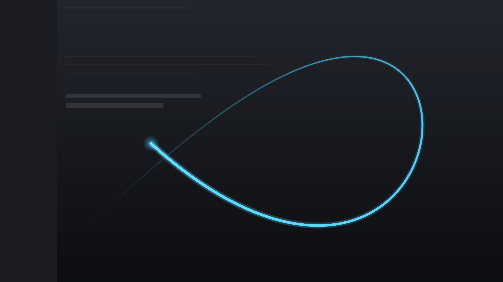

# 鼠标拖尾（Cursor Comet）

[English](README.en.md) | 中文

一个轻量的 Windows 鼠标轨迹特效小工具：透明覆盖层跟随鼠标，画出带光晕的拖尾，**不挡点击、不抢焦点**。

[](https://github.com/cwslz/cursor-comet/actions/workflows/build.yml)
[](https://github.com/cwslz/cursor-comet/releases/latest)
[](LICENSE)



## 下载 / 快速开始

### 安装版（推荐）

从 [Releases](https://github.com/cwslz/cursor-comet/releases/latest) 下载 `CursorComet-Setup.exe`，双击安装。

- 默认安装到 `%LOCALAPPDATA%\Programs\CursorComet`，不需要管理员权限；
- 安装界面参考 Everything 的经典向导：欢迎/语言 → 许可协议 → 安装位置（含所需/可用空间）→ 安装进度 → 完成；
- 完成页可勾选“启动 Cursor Comet”，点“完成”退出；
- 自动创建开始菜单快捷方式，可选桌面快捷方式；
- 同时安装独立的 `uninstall.exe`，在“设置 → 应用”里可以直接卸载；
- 安装器里已经包含主程序，不需要另外下载 exe。

安装器只负责安装；卸载请使用“设置 → 应用 → 已安装的应用”，或直接运行安装目录里的 `uninstall.exe`。

### 便携版

下载 `cursor-comet.exe`，双击运行，不会写入安装目录；配置文件仍然在 `%APPDATA%\MouseTrail`。

需要 Windows 10 / 11，系统自带 .NET Framework 4.8。exe 未签名，SmartScreen 可能提示，点“更多信息 → 仍要运行”即可。也可以克隆仓库后运行 `build.ps1` 自行编译。

启动后没有主窗口，只在屏幕右下角托盘出现图标。移动鼠标就能看到拖尾。

| 操作 | 说明 |
| --- | --- |
| `Ctrl + Alt + T` | 开启 / 暂停特效 |
| 左键 / 右键 托盘图标 | 打开设置菜单 |
| 托盘菜单 → 退出 | 关闭程序 |

托盘菜单里可以切换：

- **样式**：流光 / 彩虹 / 星火 / 细线
- **颜色**：冰蓝 / 紫罗兰 / 樱花粉 / 金色 / 薄荷 / 白色
- **粗细**：纤细 / 标准 / 醒目
- **时长**：短（0.45 秒）/ 中（0.7 秒）/ 长（1 秒）
- **语言 / Language**：自动 / 中文 / English
- **开机自动启动**：写入当前用户的启动项（不需要管理员权限）
- **恢复默认设置**

## 特性

- **中英文双语**：托盘菜单、安装器、卸载器都可以切换语言
- 便携版是单文件 exe（约 56 KB）；安装版是一个约 150 KB 的安装器，内部已包含主程序和独立的 `uninstall.exe`
- 不需要安装 Python、Node 或 .NET SDK，使用 Windows 自带的 .NET Framework 4.8
- 逐像素透明 + 鼠标穿透（`WS_EX_LAYERED | WS_EX_TRANSPARENT`），正常点击、拖拽、输入不受影响
- 覆盖整个屏幕的透明窗口，轨迹按**固定时间**淡出：高速移动时拖尾自然变长，不会被窗口裁剪或断尾
- 支持高 DPI 缩放，拖尾粗细会按系统 DPI 自动换算
- 配置自动保存，下次启动沿用

## 配置文件

位置：`%APPDATA%\MouseTrail\config.ini`

```ini
# 样式 / Style: comet / rainbow / sparks / minimal
style=comet

# 颜色 / Color: cyan / violet / pink / gold / mint / white
color=cyan

# 0.5 ~ 2
scale=1

# 拖尾持续时间（秒）/ Duration in seconds, 0.2 ~ 1.5
life=0.7

enabled=1
showtip=0

# 语言 / Language: auto / zh / en
lang=auto
```

可以直接改文件，重启程序后生效。旧配置里的 `color=冰蓝` 会自动映射到 `cyan`。出问题时的异常日志在同目录的 `error.log`。

## 语言 / Language

- **应用内**：托盘菜单 → 语言 / Language → 自动 / 中文 / English，立即生效并保存；
- **安装器 / 卸载器**：界面上的语言下拉框，安装时会把选择写入应用配置；
- **配置文件**：`lang=auto|zh|en`，`auto` 跟随系统语言。

英文说明见 [README.en.md](README.en.md)。

## 重新编译

需要 Windows 自带的 .NET Framework 4.x（`csc.exe`）。

```powershell
.\build.ps1
```

脚本会编译：

- `dist\鼠标拖尾.exe`（中文文件名）
- `dist\cursor-comet.exe`（Release 用的 ASCII 文件名）
- `dist\uninstall.exe`（独立卸载器，安装器内嵌使用，不单独发布）
- `dist\CursorComet-Setup.exe`（安装器，内嵌便携版和卸载器）

并嵌入 `assets\app.ico` 和 `assets\app.manifest`。

改图标后可以重新生成多尺寸 ico：

```powershell
.\tools\make-icon.ps1
```

## 目录结构

```
cursor-comet/
├─ dist/                   # 本地编译输出，发布时用 Releases
│  ├─ 鼠标拖尾.exe
│  ├─ cursor-comet.exe
│  ├─ uninstall.exe
│  └─ CursorComet-Setup.exe
├─ src/                    # C# 源码
│  ├─ Program.cs           # 入口、单实例、DPI
│  ├─ TrailForm.cs         # 覆盖窗口、托盘、热键、菜单
│  ├─ TrailRenderer.cs     # 四种拖尾样式
│  ├─ TrailEngine.cs       # 轨迹采样、星火粒子
│  ├─ LayeredSurface.cs    # UpdateLayeredWindow 离屏画布
│  ├─ AppSettings.cs       # 配置读写
│  ├─ Palette.cs           # 颜色 / HSV
│  ├─ L10n.cs              # 中英文字符串表
│  ├─ IconFactory.cs       # 运行时绘制图标
│  ├─ AutoStart.cs         # 开机启动
│  └─ Native.cs            # Win32 声明
├─ installer/
│  ├─ Common.cs            # 安装器 / 卸载器共享代码
│  ├─ Setup.cs             # 安装器（内嵌主程序和卸载器）
│  └─ Uninstaller.cs       # 独立卸载器
├─ assets/
│  ├─ app.ico
│  └─ app.manifest
├─ .github/workflows/build.yml   # 打 tag 自动编译并发布 Release
├─ tools/make-icon.ps1
├─ build.ps1
├─ preview.png
├─ README.en.md
├─ CHANGELOG.md
├─ LICENSE
└─ README.md
```

## 实现说明

1. 一个无边框、置顶、`WS_EX_LAYERED | WS_EX_TRANSPARENT | WS_EX_NOACTIVATE` 的全屏窗口；
2. 用 `CreateDIBSection` 创建 32 位预乘 Alpha 位图，GDI+ 在上面绘制，再通过 `UpdateLayeredWindow` 一次性提交；
3. 每个采样点记录时间戳，按存活时间计算亮度和半径：鼠标越快，保留的轨迹越长；停手后整条拖尾在设定时间内自然淡完；
4. 平滑改用 Chaikin 切角算法，曲线始终在控制点围成的凸包内，不会像 Catmull-Rom 那样过冲打结；
5. 按弧长重采样后用圆头线段拼接出连续轨迹，线宽只由采样点的年龄决定，移动再快也不会变粗；
6. 头部叠一层径向渐变光晕，鼠标停住后光晕和拖尾一起淡出，最后把窗口刷成全透明，空闲时几乎不占用 CPU。

## 常见问题

**高速移动时尾部分叉 / 被截断？**
已经修复：轨迹不再按长度截断，而是每个采样点存活固定时间后消失；平滑用 Chaikin 算法，不会过冲形成小圈；窗口覆盖整个屏幕，不会在边缘被裁剪。

**拖尾不显示？**
- 确认托盘图标还在、菜单里“启用鼠标拖尾”是勾选状态；
- 按一下 `Ctrl + Alt + T` 试试；
- 以独占全屏运行的游戏可能盖住覆盖层，改成“无边框窗口”模式即可。

**开机启动在哪关闭？**
托盘菜单取消勾选“开机自动启动”，或删除注册表 `HKCU\Software\Microsoft\Windows\CurrentVersion\Run` 下的 `MouseTrail`。

**怎么切换语言？**
托盘菜单 → 语言 / Language；安装器和卸载器界面上也有语言下拉框。应用内切换会立即生效并保存。

**安装版怎么卸载？**
“设置 → 应用 → 已安装的应用 → Cursor Comet”，或直接运行 `%LOCALAPPDATA%\Programs\CursorComet\uninstall.exe`。卸载器会删除快捷方式和卸载项，配置文件默认保留（可在卸载器里勾选一并删除）。

**会被杀毒软件误报吗？**
程序没有联网、没有提权，只是普通的 .NET WinForms 程序；因为未签名，个别杀软可能提示，介意的话可以自己用 `build.ps1` 编译。

**多显示器？**
按主显示器的系统 DPI 换算，跨不同缩放比例的副屏时拖尾大小可能不完全一致，但位置始终跟随鼠标。

**想改成别的颜色 / 曲线？**
改 `src\Palette.cs` 里的颜色，或调 `src\TrailRenderer.cs` 顶部的 `StampSpacing`、`MaxRadius`，然后重新运行 `build.ps1`。

## 更新日志

见 [CHANGELOG.md](CHANGELOG.md)。

## 许可证

本项目采用 [GNU General Public License v3.0](LICENSE)（GPL-3.0）开源。

Copyright (C) 2026 MouseTrail contributors

你可以自由使用、修改和分发；如果分发修改后的版本，需要继续以 GPL-3.0 提供源代码。
